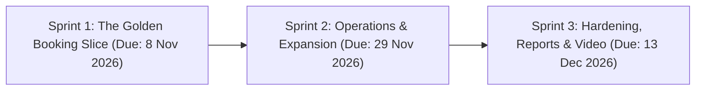

# Three-Sprint Development Plan
## Project: SingSlot — Karaoke Room Reservation & Management System
**Course:** CPE 334 Introduction to Software Engineering in the Age of AI Agents  
**Document Version:** 1.2.0 (Rigorous Engineering Baseline)  
**Date:** November 2026  

---

## 1. Overview of the Three-Sprint Development Lifecycle

The implementation of SingSlot is distributed across three disciplined sprints, prioritizing a robust, tested end-to-end domain slice in Sprint 1:

---

## 2. Sprint Breakdown

### 2.1 Sprint 1: The Golden Booking Slice (Deliverable 1 — 80 Points)
* **Submission Deadline:** Sunday, 8 November 2026 at 23:59 (Deliverable 1 Checkpoint)
* **Sprint Goal:**  
  Deliver a functional, verified end-to-end vertical slice (UI $\rightarrow$ API $\rightarrow$ PostgreSQL) focused on the customer online reservation journey with seeded demo accounts, dynamic server-calculated availability lookup (14 slots, 0..13), contiguous slot validation, atomic concurrency protection, customer booking inspection, and staff master schedule oversight.
* **Included Features:**
  * **F-01:** Seeded User Authentication & Session Lifecycle (Login, Logout, `/api/auth/me`, JWT).
  * **F-02:** Room Catalog Display (9 rooms: S01–S03, M01–M03, L01–L03).
  * **F-03:** Server-Calculated Availability Query (`GET /api/availability?date=...`).
  * **F-04:** Customer Online Booking & Conflict Prevention (1–5 contiguous hours, conflict rejection, atomic transaction).
  * **F-05:** Customer My Bookings & Booking Detail (`GET /api/bookings/my`, `GET /api/bookings/:id` with 403 ownership guard).
  * **F-06:** Staff Master Schedule Inspection (`GET /api/bookings/master`).
* **Excluded / Deferred from Sprint 1:**
  * ❌ *No Self-Registration:* Seeded accounts are utilized per course spec Section 5.2.
  * ❌ *No Walk-in Booking Counter:* Deferred to Sprint 2 to isolate the primary online flow.
  * ❌ *No Room Management CRUD:* Pre-seeded database rooms are used.
  * ❌ *No Cancellation / Rescheduling:* Deferred to Sprint 2.
  * ❌ *No Slot Maintenance Blockout:* Model created in schema; endpoints deferred to Sprint 2.
* **Verification Scope (Automated Tests):**
  * Authentication: Valid login, invalid login (401), unauthenticated access (401), and logout.
  * Domain Rules: Double-booking rejection (409 Conflict), past slot rejection (400), capacity boundary (400), and invalid duration (400).
  * Security & Privacy: Customer rejected from other customer's booking ID (403); Customer rejected from staff master schedule (403).
  * Concurrency: Parallel conflicting booking requests return one 201 and one 409.
  * Persistence: Data persists to PostgreSQL via Prisma transaction with zero orphaned rows.

---

### 2.2 Sprint 2: Operations & CI/CD Pipeline (Deliverable 2 — 70 Points)
* **Submission Deadline:** Sunday, 29 November 2026 at 23:59 + Group Labs 5 & 6
* **Sprint Goal:**  
  Extend operational workflows with staff walk-in reservations, booking cancellation and rescheduling under the 24-hour advance notice rule, slot maintenance blockout, search/filter tools, Docker packaging, and GCP cloud deployment.
* **Included Features:**
  * **F-07:** Staff Walk-in Booking Counter (`POST /api/bookings/walk-in`).
  * **F-08:** Booking Cancellation & Rescheduling (24-hour advance policy: `serverTime <= startAt - 24h`).
  * **F-09:** Staff Slot Maintenance & Blockout (`RoomBlock` management without overlapping confirmed bookings).
  * **F-10:** Booking Search & Multi-criteria Filtering (Search by customer phone, date, room).
  * **Lab 5 Execution:** Docker containerization, GCP Cloud Run deployment, and automated CI test gates.
  * **Lab 6 Execution:** Cross-team UAT test scenario exchange and defect resolution.

---

### 2.3 Sprint 3: Completion, Reporting & Hardening (Final Delivery — 100 Points)
* **Submission Deadline:** Sunday, 13 December 2026 at 23:59 + Group Lab 7
* **Sprint Goal:**  
  Complete remaining administrative tools (Self-registration, room CRUD), aggregate management reports, UI aesthetic polish, regression safety, and the final 10-minute demonstration video.
* **Included Features:**
  * **F-11:** Customer Self-Registration (`POST /api/auth/register`).
  * **F-12:** Room Management CRUD (`POST/PATCH/DELETE /api/rooms`).
  * **F-13:** Appointment Summary & Occupancy Reports (Utilization rates and peak hours).
  * **F-14:** UAT Defect Fixes, UI Polish & Final Demo Video (Aesthetic enhancements, regression safety, video demonstration: max 10 minutes per rubric / under 4 minutes per final presentation guidance).
  * **Lab 7 Execution:** Maintenance change impact analysis and regression testing.
