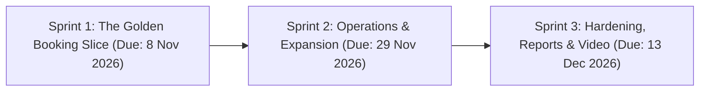
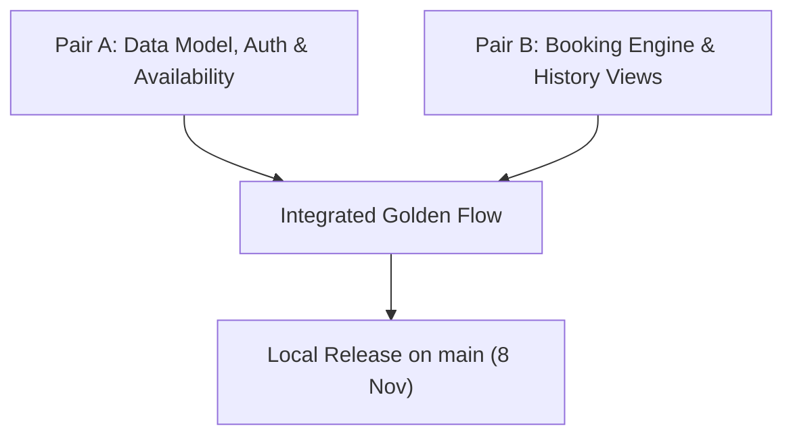

# Three-Sprint Development Plan
## Project: SingSlot — Karaoke Room Reservation & Management System
**Course:** CPE 334 Introduction to Software Engineering in the Age of AI Agents  
**Document Version:** 1.1.0 (Refined Lean-Sprint Allocation)  
**Date:** November 2026  

---

## 1. Overview of the Three-Sprint Development Lifecycle

To guarantee on-time delivery for Deliverable 1 (due 8 November 2026) while achieving all 80 points, SingSlot scopes Sprint 1 down to a **"Minimum Viable Tested Slice"** (the Golden Online Booking Journey). Ancillary operations (Walk-in booking, cancellations, self-registration, and room CRUD) are distributed across Sprints 2 and 3:

---

## 2. Sprint Breakdown

### 2.1 Sprint 1: The Golden Booking Slice (Deliverable 1 — 80 Points)
* **Submission Deadline:** Sunday, 8 November 2026 at 23:59 (Deliverable 1 Checkpoint)
* **Sprint Goal:**  
  Deliver a functional, test-verified end-to-end vertical slice (UI $\rightarrow$ API $\rightarrow$ Database) focused on the customer online reservation journey with pre-seeded accounts, dynamic availability lookup, strict contiguous slot validation, double-booking rejection, and staff master schedule inspection.
* **Included Features:**
  * **F-01:** Seeded User Authentication & Session (Login/Logout for Customer & Staff using seeded credentials; JWT session).
  * **F-02:** Room & Slot Catalog Display (Static seeded fleet: S01–S03, M01–M03, L01–L03; 14 hourly slots: 10:00–24:00).
  * **F-03:** Real-time Slot Availability Query (Calendar date selection returning live slot status per room).
  * **F-04:** Customer Online Booking & Conflict Prevention (1–5 contiguous hours, conflict prevention, past slot rejection).
  * **F-05:** Customer My Bookings (Private reservation list; cross-customer read access blocked).
  * **F-06:** Staff Master Schedule Inspection (Staff dashboard viewing all bookings across all rooms).
* **Excluded / Deferred from Sprint 1:**
  * ❌ *No Self-Registration:* Seeded accounts are sufficient per Section 5.2.
  * ❌ *No Walk-in Booking Counter:* Moved to Sprint 2 to maintain a single golden booking flow.
  * ❌ *No Room Management CRUD:* Pre-seeded database rooms are used.
  * ❌ *No Cancellation / Rescheduling:* Moved to Sprint 2.
* **Verification Scope (Automated Tests):**
  * Domain Rule: Double-booking rejection (409 Conflict) and past slot rejection (400 Bad Request).
  * Security: Customer cannot view another's bookings (403 Forbidden); Customer cannot access staff schedule (403 Forbidden).
  * Persistence: Data persists to PostgreSQL via Prisma transaction.

---

### 2.2 Sprint 2: Operational Expansion & CI/CD Pipeline (Deliverable 2 — 70 Points)
* **Submission Deadline:** Sunday, 29 November 2026 at 23:59 + Group Labs 5 & 6
* **Sprint Goal:**  
  Extend operational workflows with staff walk-in reservations, booking lifecycle actions (cancellation and rescheduling), search and filter utilities, Docker containerization, and GCP cloud deployment.
* **Included Features:**
  * **F-07:** Staff Walk-in Booking Counter (On-premise cashier reservation form).
  * **F-08:** Booking Cancellation & Rescheduling ($\ge 24$-hour advance notice policy).
  * **F-09:** Staff Slot Maintenance & Blockout (Blocking rooms/slots for maintenance).
  * **F-10:** Booking Search & Multi-criteria Filtering (Search by phone, date, room).
  * **Lab 5 Execution:** Docker containerization, GCP Cloud Run deployment, and automated CI test gates.
  * **Lab 6 Execution:** Cross-team UAT test scenario execution and defect resolution.

---

### 2.3 Sprint 3: Completion, Reporting & Hardening (Final Delivery — 100 Points)
* **Submission Deadline:** Sunday, 13 December 2026 at 23:59 + Group Lab 7
* **Sprint Goal:**  
  Complete remaining self-service and management tools (Self-registration, room CRUD), aggregate analytics reporting, UI aesthetic polish, regression testing, and final demonstration video.
* **Included Features:**
  * **F-11:** Customer Self-Registration (Public signup form with input validation).
  * **F-12:** Room Management CRUD (Staff administrative interface for managing room fleet).
  * **F-13:** Appointment Summary & Occupancy Reports (Utilization rates and peak-hour analysis).
  * **F-14:** UAT Defect Fixes, UI Polish & Final Demo Video (Aesthetic enhancements, regression safety, 10-minute video).
  * **Lab 7 Execution:** Maintenance change impact analysis and regression testing.

---

## 3. Sprint 1 Feasibility & Delivery Justification

By decoupling walk-in booking and room CRUD into Sprint 2 and 3, Sprint 1 focuses 100% of effort on building the core booking engine and establishing automated tests for all business rules required by the Deliverable 1 rubric. This ensures the two team members finish development with ample time to record screenshots and compile the required PDF report.
