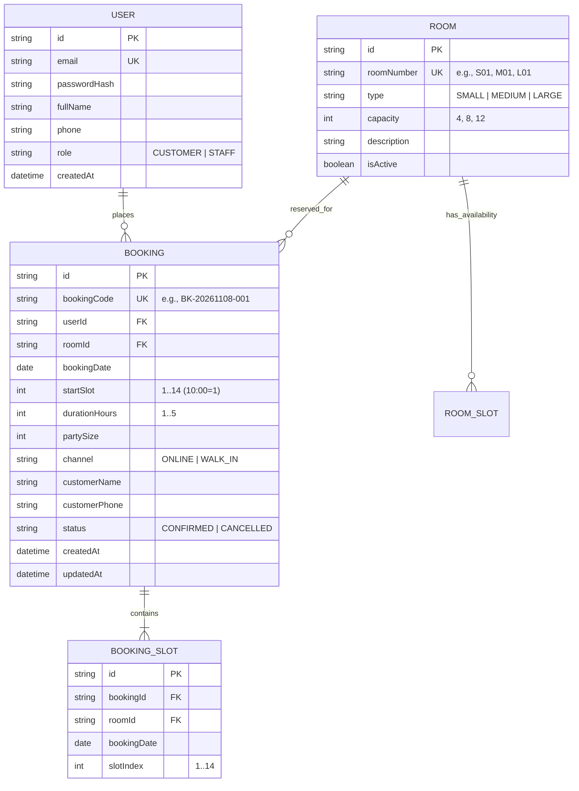

# System-Level Software Design Specification (SDS)
## Project: SingSlot — Karaoke Room Reservation & Management System
**Course:** CPE 334 Introduction to Software Engineering in the Age of AI Agents  
**Document Version:** 1.0.0  
**Date:** November 2026  

---

## 1. System Architecture & Tech Stack

SingSlot adopts a **Decoupled Full-Stack Architecture** composed of three distinct logical tiers communicating over a RESTful JSON interface:

```
+-----------------------------------------------------------------------+
|                             Client Layer                              |
|   React (Vite) + TypeScript + Tailwind CSS + Lucide Icons             |
|   - Customer Portal: Catalog, Availability Grid, Online Booking, My Bookings |
|   - Staff Cashier Portal: Master Schedule, Walk-in Counter Form       |
+----------------------------------+------------------------------------+
                                   | HTTP / HTTPS (RESTful JSON API)
                                   v
+----------------------------------+------------------------------------+
|                       API & Application Layer                         |
|   Node.js + Express.js (TypeScript)                                   |
|   - Auth & RBAC Middleware (JWT Bearer Token verification)            |
|   - Domain Services: BookingService, AvailabilityService, RoomService  |
|   - Conflict Validation & Concurrency Enforcement Engine              |
+----------------------------------+------------------------------------+
                                   | Prisma ORM (Type-Safe Data Access)
                                   v
+----------------------------------+------------------------------------+
|                            Data Layer                                 |
|   PostgreSQL Relational Database                                      |
|   - ACID Transactions for multi-slot allocation                       |
|   - Composite Unique Index: [roomId, bookingDate, slotIndex]          |
+-----------------------------------------------------------------------+
```

### 1.1 Stack Selection & Rationale
* **Frontend:** `React` with `TypeScript` and `Tailwind CSS` facilitates component modularity, rapid construction of reactive time-slot matrices, and expressive gradient styling.
* **Backend:** `Node.js` with `Express.js` provides a lightweight, non-blocking asynchronous runtime ideal for I/O-bound booking queries, role enforcement, and input sanitization.
* **Database & ORM:** `PostgreSQL` coupled with `Prisma ORM` guarantees ACID compliance and composite unique index enforcement to eradicate double-booking anomalies at the database level.

### 1.2 Business Rule Enforcement Boundaries
* **Client-Side Validation (Advisory):** Provides immediate user feedback (e.g., preventing selection $>5$ hours, disabling occupied slot buttons).
* **Server-Side Validation (Authoritative):** All business rules (continuous availability, capacity checks, past-time boundaries, and authentication) are independently validated on the server. Conflicting requests are terminated before persisting state.

---

## 2. Data Model & Database Design

### 2.1 Entity Relationship Diagram (ERD)



### 2.2 Critical Data Constraints & Concurrency Safeguards
* **Composite Unique Constraint:** To guarantee zero overlapping bookings under concurrent load, the `BOOKING_SLOT` entity enforces:
  ```prisma
  @@unique([roomId, bookingDate, slotIndex])
  ```
  Any competing transaction attempting to insert a duplicate room-date-slot tuple is immediately rejected by PostgreSQL with a unique constraint violation error (P2002), mapped by Express to HTTP 409 Conflict.
* **Transactional Multi-Slot Allocation:** Booking requests covering multiple hours are wrapped in `prisma.$transaction`. Either all requested slots are allocated or the entire operation rolls back.

### 2.3 Reproducible Seed Data
The database seed script (`npm run prisma:seed`) populates:
* **Staff Account:** `staff@singslot.local` / `Pass1234!` (`role: "STAFF"`)
* **Customer Accounts:**
  * `alice@singslot.local` / `Pass1234!` (`role: "CUSTOMER"`)
  * `bob@singslot.local` / `Pass1234!` (`role: "CUSTOMER"`)
* **Room Fleet (9 units):**
  * Small: `S01`, `S02`, `S03` (Capacity: 4)
  * Medium: `M01`, `M02`, `M03` (Capacity: 8)
  * Large: `L01`, `L02`, `L03` (Capacity: 12)
* **Pre-existing Reservation:** Room `S01` has Slot 4 (13:00–14:00) pre-reserved on test dates to verify the contiguous slot rejection rule (`TEST-04b`).

---

## 3. UI, API & Access Conventions

### 3.1 Role & Permission Matrix

| Operation / Endpoint | Anonymous | Customer | Staff | Record-Level Ownership Rule |
|---|:---:|:---:|:---:|---|
| `POST /api/auth/login` | Allowed | Allowed | Allowed | Public authentication |
| `POST /api/auth/register` | Allowed | - | - | Public customer onboarding |
| `GET /api/auth/me` | Blocked | Allowed | Allowed | Self profile inspection |
| `GET /api/rooms` | Allowed | Allowed | Allowed | Public catalog query |
| `GET /api/availability` | Allowed | Allowed | Allowed | Public schedule inspection |
| `POST /api/bookings/online` | Blocked | Allowed | Blocked | Customer submits online reservation (`userId == token.sub`) |
| `POST /api/bookings/walk-in` | Blocked | Blocked | Allowed | Staff creates on-premise walk-in entry |
| `GET /api/bookings/my` | Blocked | Allowed | Blocked | Customer accesses strictly their own reservations |
| `GET /api/bookings/master` | Blocked | Blocked | Allowed | Staff inspects all bookings across all rooms |
| `PATCH /api/bookings/:id/cancel` | Blocked | Allowed | Allowed | Customers may cancel only their own bookings; Staff may cancel any *(Sprint 2)* |

### 3.2 Token Lifecycle & Authentication Mechanics
1. **Password Hashing:** Stored credentials are salted and hashed using `bcryptjs` with 10 rounds.
2. **Token Issuance:** Upon successful authentication, the server emits a signed JWT containing payload: `{ sub: userId, role: "CUSTOMER" | "STAFF", email: string }`.
3. **Token Transmission & Expiry:** Clients submit tokens via the standard `Authorization: Bearer <token>` header. Tokens expire after 8 hours.
4. **Session Termination (Logout):** Client purges the stored token from storage; subsequent requests fail authorization checks.

### 3.3 API Conventions & Error Formats
* **Standard Success Format (HTTP 200 / 201):**
  ```json
  {
    "success": true,
    "data": { ... }
  }
  ```
* **Standard Error Format (HTTP 400 / 401 / 403 / 409):**
  ```json
  {
    "success": false,
    "error": {
      "code": "SLOT_CONFLICT",
      "message": "One or more selected slots are already booked."
    }
  }
  ```

---

## 4. Configuration & Deployment Design

### 4.1 Environment Configuration
Configuration is externalized through environment variables (committed as `.env.example`, with actual `.env` git-ignored):
* `PORT`: Server listening port (default: `5001`).
* `DATABASE_URL`: PostgreSQL connection string.
* `JWT_SECRET`: Cryptographic signing key for token verification.
* `NODE_ENV`: Runtime mode (`development`, `test`, `production`).

### 4.2 Docker Containerization & Cloud Deployment Plan (Lab 5 Alignment)
* The architecture separates frontend and backend containers:
  * **Backend Container:** Multi-stage Node.js container with Prisma engine dependencies.
  * **Frontend Container:** Static build served via an Nginx alpine container.
* **Persistent Storage:** Cloud SQL or a detached persistent database volume ensures data survives application restarts or redeployments.
